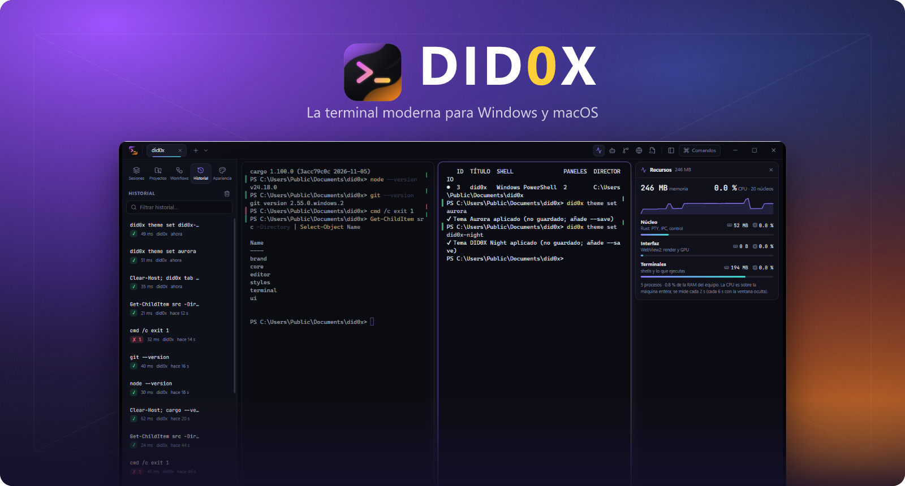
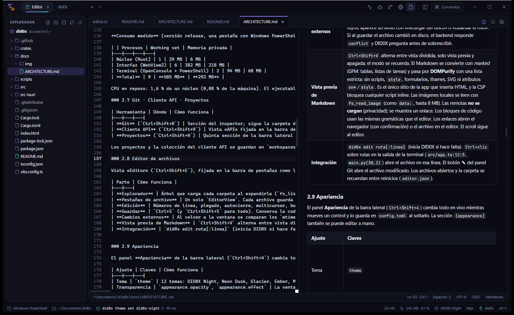
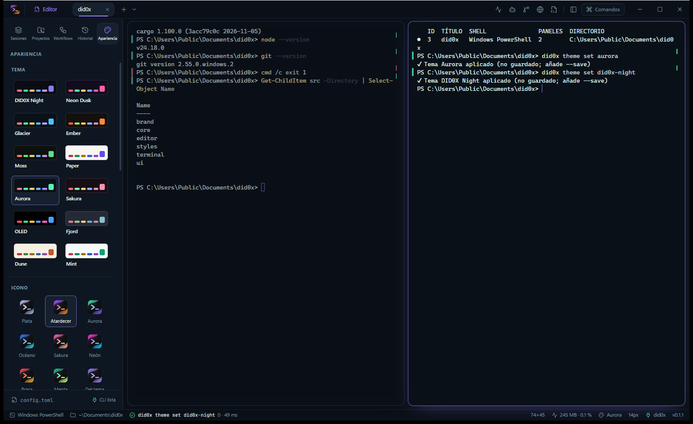
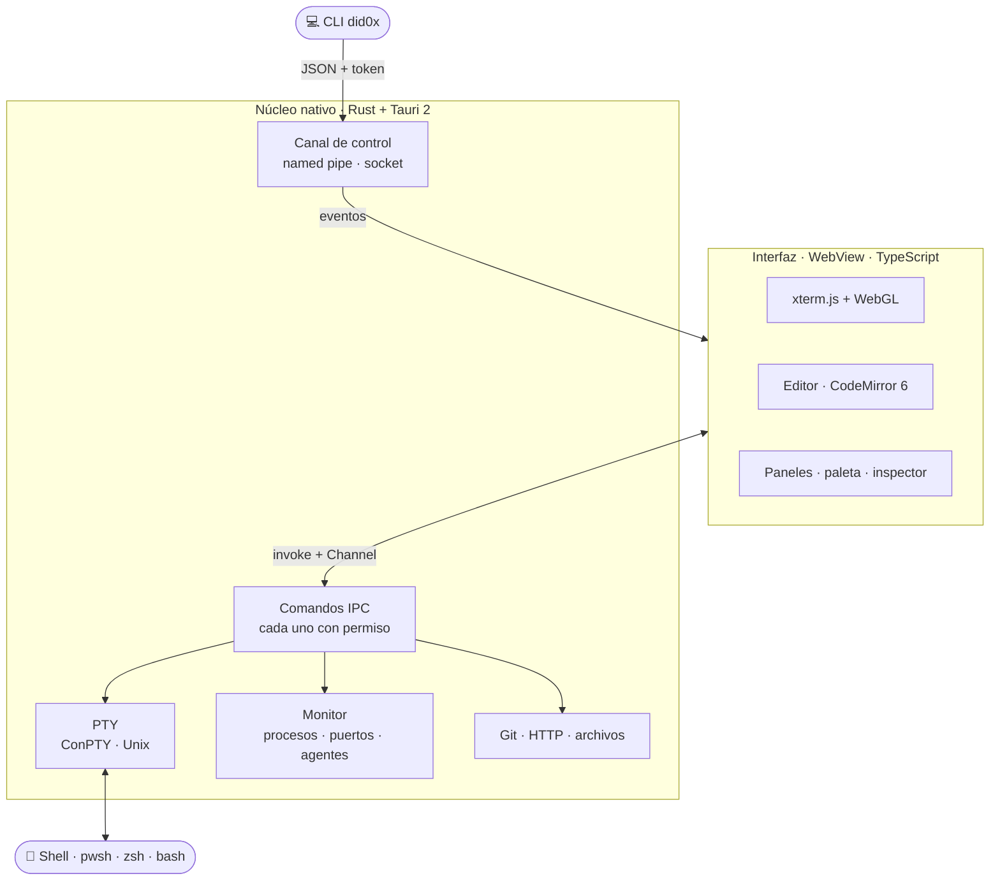
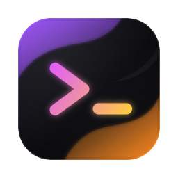

<div align="center">



### Paneles como iTerm2 · bloques y paleta como Warp · nativa y ligera como Ghostty

Una terminal de escritorio hecha con **Rust + Tauri 2**: rápida, bonita y con todo lo que usas a diario
(Git, cliente HTTP, editor, agentes de IA y puertos) en la misma ventana.

<br>

[](#-descargar-e-instalar)
[](#-descargar-e-instalar)

[](https://tauri.app)

[](https://github.com/HKTamilo/DID0X-releases/releases)
[](#%EF%B8%8F-hoja-de-ruta)

<br>

[](https://github.com/HKTamilo/DID0X-releases/releases/latest)
&nbsp;
[](https://github.com/HKTamilo/DID0X-releases/releases/latest)

**[Funciones](#-funciones)** · **[Instalar](#-descargar-e-instalar)** · **[Atajos](#%EF%B8%8F-atajos)** · **[CLI](#-la-cli-did0x)** · **[Arquitectura](#%EF%B8%8F-arquitectura)** · **[Desarrollo](#%EF%B8%8F-desarrollo)**

</div>

---

## ✨ Funciones

<table>
<tr>
<td width="50%" valign="top">

### 🖥️ Terminal
- **Pestañas y paneles** divididos (`Ctrl+Shift+D` / `Ctrl+Shift+J`) con foco por flechas.
- **Bloques de comandos**: cada comando lleva una barra verde o roja con su código de salida. Con un clic copias el comando, copias la salida o lo repites.
- **Historial** con duración, carpeta y resultado de cada comando.
- **Paleta** (`Ctrl+Shift+P`) con búsqueda difusa de acciones, temas, pestañas y workflows.
- **Workflows** reutilizables con parámetros `{{nombre}}`.
- Funciona con PowerShell, cmd, Git Bash, WSL, zsh, bash y fish.

</td>
<td width="50%" valign="top">

### 🧰 Herramientas integradas
- **Git**: rama, cambios, diff, commit, cambio de rama, pull y push.
- **Cliente API**: peticiones HTTP con cabeceras, cuerpo y variables, y un visor de JSON en árbol. Sin Postman.
- **Proyectos**: cada uno con su carpeta, su color y sus terminales, que abres todas con un clic.
- **Agentes**: detecta Claude Code, Codex, Gemini, Grok, Aider… y muestra qué hacen.
- **Puertos y Tailscale**: qué escucha en cada puerto, con su título web.
- **Recursos**: cuánta memoria y CPU usa la propia terminal.

</td>
</tr>
</table>

### 📝 Editor de archivos con vista previa de Markdown

Explorador con colores de git, pestañas de archivo, resaltado de más de 20 lenguajes, buscar y reemplazar, y `Ctrl+P` para saltar a cualquier archivo. Si un archivo cambia en disco, te avisa. Puedes abrir archivos desde la terminal con `did0x edit archivo.ts:42` o con **Ctrl+clic** sobre una ruta en la salida de un comando.



### 🎨 Apariencia a tu gusto

12 temas, **ventana translúcida** (Mica, Acrílico o desenfoque en Windows; materiales *vibrancy* en macOS), colores propios, fuentes, grosor, interlineado, redondez, densidad y un **icono que cambia de color**. Todo se ve en vivo y se guarda en `config.toml`.



---

## 📦 Descargar e instalar

Las versiones compiladas están en **[Releases](https://github.com/HKTamilo/DID0X-releases/releases)**. Las genera GitHub Actions en cada versión nueva.

> **🔄 Se actualiza sola.** DID0X busca versiones nuevas al abrirse y cada 6 horas. Cuando hay una, te avisa con un botón *Actualizar y reiniciar*. Cada descarga está firmada y la app comprueba la firma antes de instalarla. También puedes buscar a mano con la paleta (*Buscar actualizaciones*) o haciendo clic en el número de versión de la barra de estado. Para desactivarlo: `[updates] check = false`.

| Sistema | Archivo | Requisitos |
|---|---|---|
| **Windows** | `DID0X_…_windows-x64-setup.exe` | Windows 10 1809+ (WebView2 viene con Windows 11) |
| **macOS · Apple Silicon** (M1–M4) | `DID0X_…_apple-silicon.dmg` | macOS 11+ |
| **macOS · Intel** | `DID0X_…_intel.dmg` | macOS 11+ |

<details>
<summary><b>🪟 Windows</b></summary>

<br>

Ejecuta el instalador. Se instala **solo para tu usuario** (sin permisos de administrador), crea accesos directos en el escritorio y el menú Inicio, y añade la CLI `did0x` a tu PATH. Si Windows SmartScreen avisa, es porque el instalador aún no está firmado: pulsa *Más información → Ejecutar de todas formas*.

```
%LOCALAPPDATA%\DID0X\
├─ did0x-app.exe         la terminal
├─ bin\did0x.exe         la CLI (en tu PATH)
└─ conpty\               ConPTY moderno de Microsoft (MIT)
%APPDATA%\did0x\config.toml   tu configuración (se conserva al desinstalar)
```

</details>

<details>
<summary><b>🍎 macOS</b></summary>

<br>

1. Abre el `.dmg` y arrastra **DID0X** a **Aplicaciones**.
2. La app aún no está firmada por Apple, así que la primera vez macOS la bloquea. Ábrela con **clic derecho → Abrir** o quita la cuarentena una sola vez:
   ```bash
   xattr -dr com.apple.quarantine /Applications/DID0X.app
   ```
3. Para usar la CLI desde cualquier terminal:
   ```bash
   sudo ln -sf /Applications/DID0X.app/Contents/MacOS/did0x /usr/local/bin/did0x
   ```

**Diferencias con Windows:**
- La ventana usa los botones nativos de macOS.
- Los atajos usan **⌘**, así que `Ctrl+C`, `Ctrl+R` y el resto quedan libres para el shell.
- zsh se abre como *login shell* (carga tu `.zprofile` y Homebrew) y los bloques de comandos funcionan sin tocar tus archivos.
- La app toma el PATH de tu shell aunque la abras desde el Dock.

</details>

---

## ⌨️ Atajos

| Acción | Windows | macOS |
|---|---|---|
| Paleta de comandos | `Ctrl+Shift+P` · `F1` | `⌘⇧P` |
| Nueva pestaña · cerrar | `Ctrl+Shift+T` · `Ctrl+Shift+W` | `⌘T` · `⌘W` |
| Dividir a la derecha · abajo | `Ctrl+Shift+D` · `Ctrl+Shift+J` | `⌘D` · `⌘⇧D` |
| Moverse entre paneles | `Alt+←↑→↓` | `⌥←↑→↓` |
| Copiar · pegar | `Ctrl+C` (con selección) · `Ctrl+V` | `⌘C` · `⌘V` |
| Buscar · limpiar | `Ctrl+Shift+F` · `Ctrl+Shift+K` | `⌘F` · `⌘K` |
| Comando anterior · siguiente | `Ctrl+Shift+↑/↓` | `⌘⇧↑/↓` |
| Barra lateral (Sesiones · Proyectos · Workflows · Historial · Apariencia) | `Ctrl+Shift+B` · `Ctrl+Shift+1…4` | `⌘⇧B` · `⌘⇧1…4` |
| Agentes · Puertos · Recursos · Git | `Ctrl+Shift+5 / 6 / 7 / 8` | `⌘⇧5 / 6 / 7 / 8` |
| Cliente API · Proyectos · Editor | `Ctrl+Shift+9 / 0 / E` | `⌘⇧9 / 0 / E` |
| En el editor | `Ctrl+P` archivo · `Ctrl+S` guardar · `Ctrl+Shift+V` vista previa | `⌘P` · `⌘S` · `⌘⇧V` |

En Windows, `Ctrl+C` solo copia si hay texto seleccionado; si no, interrumpe el comando, igual que en Windows Terminal. Las teclas se leen por su posición física, así que funcionan con teclado español, latinoamericano o inglés.

---

## 💻 La CLI `did0x`

Controla DID0X desde cualquier terminal (o script) a través de un canal local con token.

```bash
did0x open                       # abre DID0X o lo trae al frente
did0x tab new --cwd ~/proyecto   # pestaña nueva en esa carpeta
did0x split down                 # divide el panel activo
did0x run -- npm test            # escribe y ejecuta en el panel activo
did0x edit src/app.ts:42         # abre el archivo en el editor, en la línea 42
did0x theme set aurora --save    # cambia el tema y lo guarda
did0x doctor                     # revisa la instalación y explica cómo arreglarla
```

| Opción global | Qué hace |
|---|---|
| `--json` | Salida JSON estable (también en los errores), lista para scripts |
| `--no-color` / `NO_COLOR` | Sin colores |
| `-q` · `-v` | Menos o más detalle |

Códigos de salida: `0` éxito · `2` uso incorrecto · `3` DID0X no está abierto · `4` configuración inválida · `5` no encontrado · `6` no autorizado · `7` tiempo agotado.

---

## 🏗️ Arquitectura



| Capa | Tecnologías |
|---|---|
| **Núcleo** | Rust · Tauri 2 · portable-pty · ConPTY empaquetado · tokio · sysinfo · reqwest |
| **Interfaz** | TypeScript · Vite · xterm.js (WebGL) · CodeMirror 6 · marked + DOMPurify · Lucide |
| **CLI** | Rust · clap · named pipes (Windows) / sockets Unix (macOS) |
| **Distribución** | Instalador NSIS (Windows) · `.app` + `.dmg` (macOS) · GitHub Actions |

**Seguridad.** Cada comando que la interfaz puede invocar requiere un permiso explícito, y la CSP es estricta (sin `eval` ni red). Hay protección al pegar varias líneas, el portapapeles OSC 52 está denegado y los enlaces se confirman. La CLI se autentica con un token de 256 bits. Las rutas se validan y lo que borras va a la papelera.

---

## 🛠️ Desarrollo

Requisitos: **Rust 1.80+** y **Node 22+**. En Windows hace falta WebView2; en macOS, las Xcode Command Line Tools.

```bash
npm install
npm run app:dev        # DID0X en modo desarrollo (recarga en caliente)
npm test               # pruebas de Rust (núcleo, configuración, protocolo, archivos, git)
npm run app:build      # Windows: instalador NSIS en target/release/bundle
./scripts/build-macos.sh   # macOS: DID0X.app y .dmg
```

```
crates/did0x-core   núcleo compartido: configuración, temas, shells, protocolo
crates/did0x-cli    la CLI did0x
src-tauri           app de escritorio (Rust): PTY, IPC, monitor, git, http, archivos
src                 interfaz (TypeScript): terminal, editor, inspector, paneles
scripts             compilación para macOS, iconos, portada y actualización de ConPTY
docs                arquitectura, decisiones e imágenes
```

<details>
<summary><b>⚙️ Configuración (<code>config.toml</code>)</b></summary>

<br>

Se recarga sola al guardar y `did0x config validate` explica cada error con línea y sugerencia.

```toml
theme = "did0x-night"

[font]
family = "JetBrains Mono"
size = 14

[appearance]
opacity = 0.85        # < 1 = ventana translúcida
effect = "acrylic"    # none | mica | acrylic | blur
icon = "sunset"       # silver | sunset | aurora | ocean | sakura | neon | ember | mint | theme

[updates]
check = true          # buscar versiones nuevas al abrir y cada 6 horas

[shell]
program = ""          # vacío = automático (pwsh / zsh…)

[[workflows]]
name = "Desplegar"
command = "npm run deploy -- --env {{entorno}}"
```

</details>

---

## 🗺️ Hoja de ruta

- [x] Terminal con pestañas, paneles, bloques, historial y paleta
- [x] Inspector: agentes, puertos y Tailscale, recursos, Git
- [x] Cliente API, proyectos y editor con vista previa de Markdown
- [x] Apariencia: temas, transparencia, icono dinámico
- [x] macOS (Apple Silicon e Intel)
- [x] Actualizaciones automáticas firmadas
- [ ] Firma de código (Windows y Apple)
- [ ] Linux (AppImage / .deb)
- [ ] Sesiones que sobreviven al reinicio

<div align="center">
<br>

<br>
<sub>Hecho con Rust, Tauri y mucho café ☕</sub>
</div>
